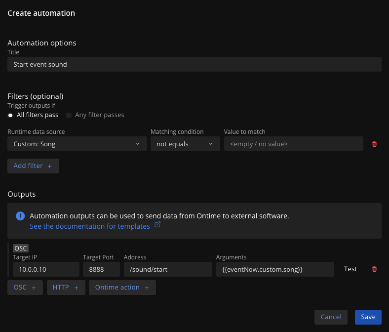
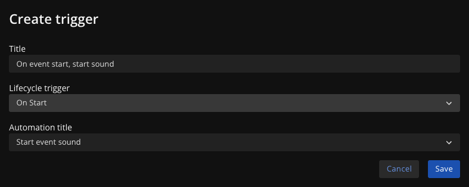

Send messages to other tools when something happens in Ontime. For example, send an OSC cue to your sound desk when an event starts.

Set it up in `Editor` -> `Settings` -> `Automation`. It has two parts:

1. An **automation**: the messages to send, and optional filters that decide whether to send them.
2. A **trigger**: the moment that runs the automation, such as **On Start**.

## Create an automation

An automation can send OSC messages, HTTP requests, or Ontime actions such as controlling an [auxiliary timer](/features/aux-timer/). \
Add filters to send only when a condition is true.



Here, the automation checks that a custom field is not empty, then sends its value over OSC. \
See [Send OSC from Ontime](/quick-tips/send-osc/) for how Ontime builds OSC payloads.

## Connect it to a trigger



Here, the trigger runs the automation when an event starts.

| Trigger | When it runs |
| :--- | :--- |
| **On Load** | An event is loaded |
| **On Start** | An event starts |
| **On Pause** | The timer is paused |
| **On Stop** | Playback stops |
| **On Finish** | The timer passes zero |
| **On Warning** | The timer reaches the event's warning time |
| **On Danger** | The timer reaches the event's danger time |
| **On Timer Update** | Every second while a timer is running |
| **Every second** | Every second, whether or not a timer is running |

## Put Ontime data in a message

Write `{{...}}` around a variable, and Ontime replaces it with the current value when the message is sent.

```
/sound/cue/{{eventNow.cue}}
```

| Variable | Value |
| :--- | :--- |
| `{{eventNow.title}}` | Title of the current event |
| `{{eventNow.cue}}` | Cue of the current event |
| `{{eventNow.custom.<field-key>}}` | A [custom field](/features/custom-fields/) of the current event. Find the key in the Custom fields settings |
| `{{eventNext.title}}` | Title of the next event |
| `{{groupNow.title}}` | Title of the current group |
| `{{timer.current}}` | The running timer, in milliseconds |
| `{{timer.playback}}` | `play`, `pause`, `armed`, `stop` or `roll` |
| `{{rundown.selectedEventIndex}}` | Position of the loaded event |
| `{{auxtimer1.current}}` | Value of auxiliary timer 1, in milliseconds |

Any field in the [runtime data](/api/data/runtime-data/) works. Join the names with dots, as in the examples. \
To see the live values, load an event and open `http://<ip-address>:<port>/api/poll` in a browser.

### Human-readable times

Runtime data is in milliseconds. For times people will read, use these variables instead:

| Variable | Value |
| :--- | :--- |
| `{{human.clock}}` | The current time, as `hh:mm:ss` |
| `{{human.runningTimer}}` | The running timer |
| `{{human.duration}}` | The duration of the current timer |
| `{{human.elapsedTime}}` | The time elapsed in the current timer |
| `{{human.startedAt}}` | When the current timer started |
| `{{human.expectedEnd}}` | When the current event is expected to finish |

Timer values are `null` when no event is loaded.
