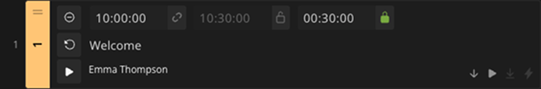
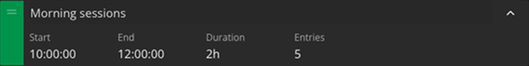
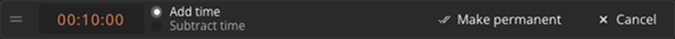

import { YouTube } from "@astro-community/astro-embed-youtube";

A rundown is your show's running order, with timings. Ontime turns it into timers, and tells the team when the show drifts from the plan.

You build the rundown in the [Editor](/interface/production/app-editor/), which opens when you start Ontime.

## What goes in a rundown

| Entry | What it is for | Example | Has a timer |
| --- | --- | --- | --- |
| **Event** | A segment of the show | A speaker, a video, a song | Yes |
| **Group** | Related entries kept together | All speakers in a panel, Act 1 | Totals of its events |
| **Milestone** | A note for the operator | Fireworks standby | No |
| **Delay** | A schedule change for the team | Doors open 10 minutes late | No |

### Events

Events generate the timers shown in the stage timer and other views. Their durations add up to the group and rundown totals. \
See [smart time entry](/quick-tips/smart-time-entry/) to type times quickly.

<YouTube id="aIvRbApvplo" title="Ontime Tutorials: Working with Events" />

### Groups

A group takes its schedule from the entries inside it. Use groups to move or clone several entries at once, and to count down to the end of a section.

### Milestones

Milestones are notes for the operator. They have no schedule, and do not show in schedule views such as Backstage.

:::tip[I just want some stage timers]
Ontime also works for simple stage-timer setups. \
Create a list of events with the timers you need (for example, 1 min, 5 min, and 10 min), and use groups, milestones, offsets, and metadata when they help your production.
:::

### Delays

A delay tells the team about a schedule change, without changing the plan. Delays show in all views. See [managing delays](/quick-tips/managing-delays/).

## Share the rundown with your team

Each person opens the view for their role in a browser:

- the [Cuesheet](/interface/production/cuesheet/) for departments to follow and add their own data
- the [Operator](/interface/production/operator/) view for operators and stage managers
- [stage timers and other displays](/interface/) for presenters and signage

See [network and security](/additional-notes/network-and-security/) to open Ontime on other devices.

## Export or print the rundown

Ontime has no print button. [Export the rundown to Excel](/quick-tips/import-export/) or [Google Sheets](/features/import-spreadsheet-gsheet/), then style and print it there.
