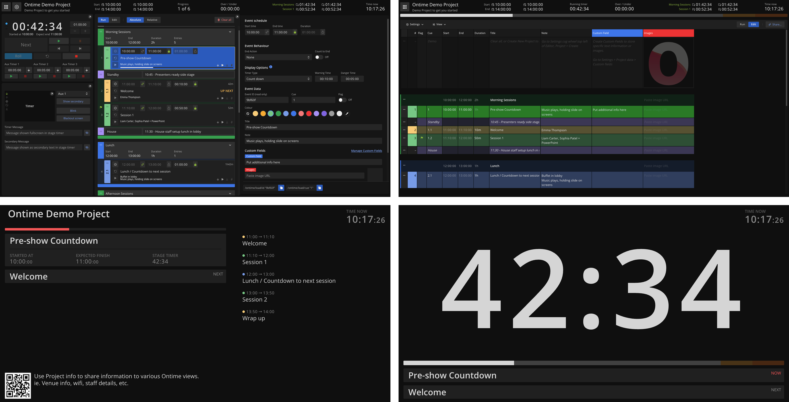

import { CardGrid, LinkCard } from "@astrojs/starlight/components";

Ontime is one live rundown that every department and display reads from, from planning through to show time. \
Build the run of show, then use the same data for cueing, stage timers, collaboration and integrations.

- **Plan the show**: build a rundown, import it from Excel or Google Sheets, and group segments and milestones.
- **Run it live**: drive timers from an operator screen, or let the system clock run the rundown on its own in [Roll mode](/quick-tips/roll/).
- **Keep everyone in sync**: give directors, operators, presenters and crew a view for their role, in any browser.
- **Manage delays**: communicate runtime delays to the whole team in real time.
- **Connect your tools**: control Ontime with HTTP, WebSocket, OSC, Bitfocus Companion or the MCP server.

Run it as a desktop app on Windows, macOS or Linux, self-host it with Docker, or use Ontime Cloud. All three use the same project format.

## Where to start

<CardGrid>
  <LinkCard
    title="Getting started"
    href="/ontime/getting-started/"
    description="Install Ontime, build your first rundown, and choose where to run it"
  />
  <LinkCard
    title="How a rundown works"
    href="/concepts/rundown/"
    description="Events, groups, milestones and delays"
  />
  <LinkCard
    title="Ontime Cloud"
    href="/ontime-cloud/"
    description="Run Ontime online, without managing a server"
  />
  <LinkCard
    title="Integrations and API"
    href="/api/"
    description="Connect Companion, vMix, scripts and AI agents"
  />
</CardGrid>

:::tip[Have an idea?]
Ontime is under active development, and we add features in collaboration with users. \
Email [mail@getontime.no](mailto:mail@getontime.no), [open an issue on GitHub](https://github.com/cpvalente/ontime/issues), or join us on [Discord](https://discord.com/invite/eje3CSUEXm) or [Reddit](https://www.reddit.com/r/ontimeapp/).
:::
