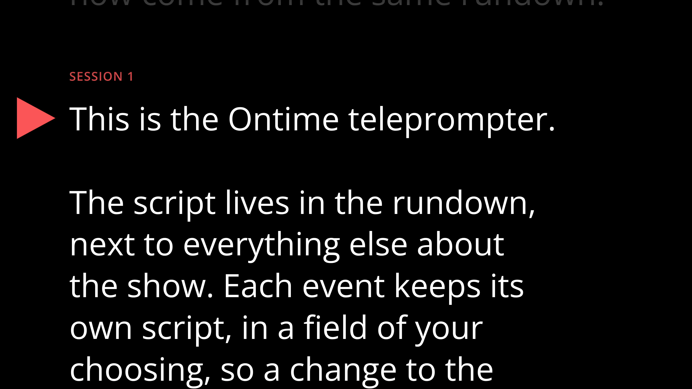

```bash title="Teleprompter"
https://cloud.getontime.no/my-stage/teleprompter           
```

The <mark>Teleprompter</mark> view shows the script of your rundown as large, scrolling text for the person on stage. \
The script lives in the rundown, next to everything else about the show. Each event keeps its own script, so a change to the running order is a change to the script.



:::note[Completely controllable over Companion]
The teleprompter playback can be fully controlled from [Bitfocus Companion](/additional-notes/companion-module): play and pause, speed, previous and next event, jumping to an event or the top of the script, nudging the script, switching the reading mode and blacking out the follower screens. No keyboard needed. \
This applies to the shared playback followed by Controller and Follower screens. An Independent screen scrolls on its own.
:::

## What you see

- **The script** of the loaded event, broken into lines with the same number of characters on every screen
- **Event headings** above each script, showing the event title, cue, both, or nothing
- **A reading marker** which shows where the presenter should be reading

## Setting up the script

The script is read from a field of your rundown: the event note, the title, or any text [custom field](/features/custom-fields). \
Choose the field, the line length and the event heading in `Editor` -> `Settings` -> `Teleprompter`. These settings are shared by every teleprompter screen in the project.

## Screen roles

Each screen has a role, set in the view options. The role is saved in the URL as `role`.

- **Independent** (`local`, default): scrolls on its own, other screens are not affected
- **Controller** (`controller`): moves every Follower screen along with it
- **Follower** (`remote`): shows where the Controller is reading and cannot scroll. This is the screen for your presenter

A typical setup is a Follower screen in front of the presenter, with the operator working from a Controller screen or from Companion.

## Playback

The teleprompter reads on like a media player, with a reading speed in lines per minute. It can read in two modes:

- **Event by event**: follows the event loaded in Ontime and stops at the end of each script
- **Whole script**: reads continuously through the script of every event

A Controller screen can also **black out** every Follower. The text disappears while the playback carries on underneath.

Press `?` in an Independent or Controller screen to see the keyboard shortcuts. \
`Space` plays and pauses, `←` and `→` change the speed, and `Shift` with `↑` or `↓` moves between events.

## Customising the view

The reading layout is configured in the view options: text width, line spacing, reading position, mirroring for reflected teleprompters, and whether to hide the reading marker or the event headings.

:::tip[Sharing your configuration]
All of the options are saved in the URL, so that you can create a [URL Presets](/features/url-presets/), **bookmark** or simply **share** the URL with all your configurations.
:::

## Use cases

- **Keynotes and speeches** — the full script in front of the speaker, following the show as events are loaded
- **Hosts and presenters** — one operator paces the script from a Controller screen or a Companion button
- **Multi-screen stages** — several Follower screens, with their own layout or mirroring, all reading the same position
