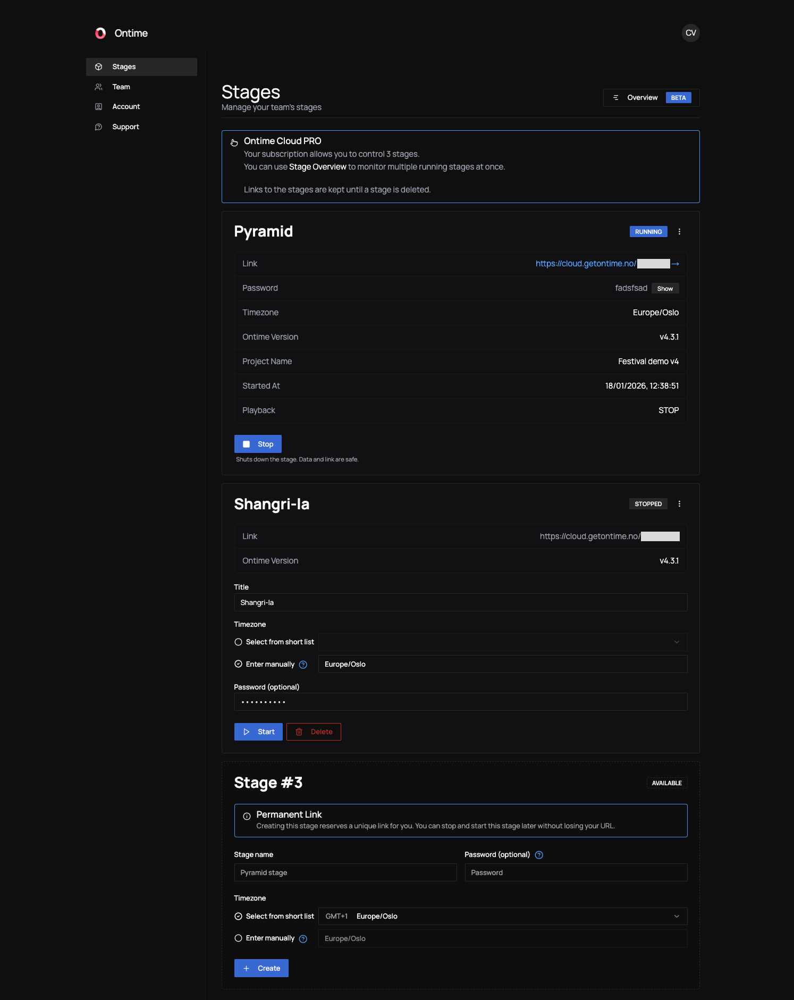

import { Steps } from "@astrojs/starlight/components";

Ontime Cloud is Ontime, hosted for you. \
Start a stage from the dashboard, send one link, and run your show from any browser. You have no server to install and no network to configure.

## Why use Ontime Cloud

- **Stages without servers.** Each stage is a full Ontime instance with its own HTTPS link. The link stays the same when you stop and start the stage, so you can send it out days before the show.
- **Share safely with anyone.** Give crew, clients and talent a read-only link to the rundown. They need no login and never reach the editor.
- **See every room at once.** The Overview shows all your running stages on one timeline.
- **Built for teams.** Invite as many people as you need, with no per-seat pricing, and keep archives of every version of the show.

## Ontime Cloud vs the desktop app and self-hosting

| | Desktop app | Self-hosted (Docker) | Ontime Cloud |
| --- | --- | --- | --- |
| Cost | Free, open source | Free, open source | Paid subscription |
| Who runs the server | Your computer | You | Ontime |
| Access from outside the venue | You set up the network | You set up the network | A stable HTTPS link per stage |
| Project format | Ontime `.json` | Same | Same, [move projects](/ontime-cloud/features/#move-a-project-between-local-and-cloud) at any time |
| Companion, HTTP and WebSocket API, MCP server | Yes | Yes | Yes, using the stage link |
| OSC, including automation outputs | Yes | Yes | No |
| Automation to devices on your local network | Yes | Yes | No |
| Read-only share links, archives, Overview | No | No | Yes |
| Team dashboard and roles | No | No | Yes |

### When to run Ontime yourself

Cloud stages run on the internet, not on your production network. Use the [desktop app or self-host with Docker](/ontime/getting-started/) when you need:

- **OSC**, including OSC automation outputs. In Cloud, use the [HTTP or WebSocket API](/api/) instead.
- [Automation](/api/automation/) outputs that reach devices only available on your local network.
- A show that keeps running when the venue has no internet connection.

## Pricing and demo

There is no free trial. See [plans and pricing](https://www.getontime.no/pricing), or [ask us for a demo](mailto:mail@getontime.no) and we will walk you through your workflow.

## Get started

<Steps>

1. **Subscribe.** On the [pricing page](https://www.getontime.no/pricing), choose **Sign up to PRO**, enter your email and a password, and pay by card. You land on the dashboard.

2. **Create a stage.** On **Stages**, click **Create Stage**, give it a name, an optional password and a timezone, then click **Create stage**. It starts straight away.

3. **Open it.** Click **Open Ontime** to open the stage in a new tab. From here, Ontime works the same as a local install. To start from an existing show, [upload a project file](/ontime-cloud/features/#upload-a-project-to-a-stage).

4. **Bring in your team.** [Invite the people](/ontime-cloud/team-and-account/#invite-someone) who manage stages with you, and [send a share link](/ontime-cloud/share-links/) to everyone who only needs to follow along.

</Steps>

:::note
It can take a moment for the payment to be confirmed. If the dashboard still says **Subscription required** right after checkout, wait a few seconds and reload the page.
:::

Next: learn how to [create and run stages](/ontime-cloud/stages/).
