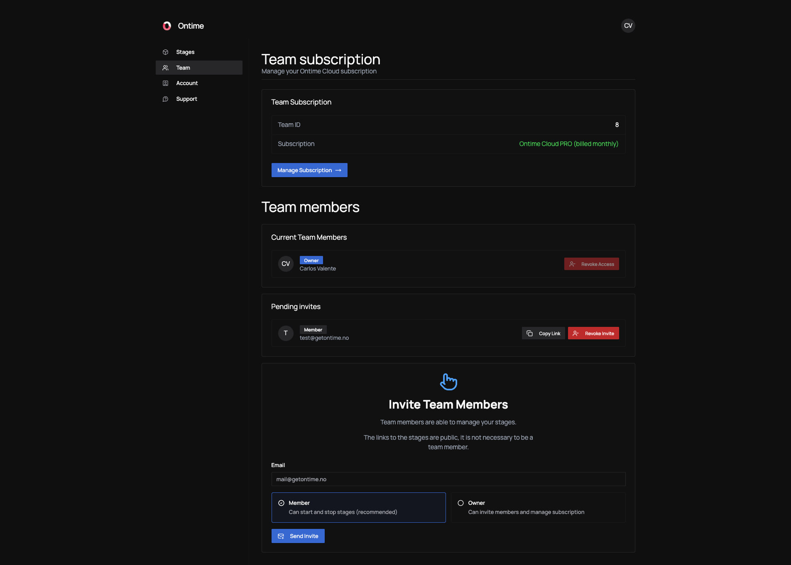

import { Steps } from "@astrojs/starlight/components";

Your stages, archives, share links and subscription belong to your **team**. \
Invite as many people as you need: there is no per-seat pricing.

## Who needs an invite

Invite the people who manage stages in the dashboard.

Everyone else can work without an account:

- Operators and crew can open a running stage with its link, and the [stage password](/ontime-cloud/stages/#set-a-stage-password) if you set one.
- People who only follow the show can use a [read-only share link](/ontime-cloud/share-links/).

## Roles

| | Member | Owner |
| --- | --- | --- |
| Create, start, stop, upgrade and delete stages | Yes | Yes |
| Upload and download projects | Yes | Yes |
| Create and manage archives and share links | Yes | Yes |
| Invite and remove people | No | Yes |
| Manage the subscription | No | Yes |

**Member** suits most people, such as the technicians who run your shows. \
The person who creates the team is its first Owner, and a team can have more than one.

## Invite someone

Only Owners can invite.

<Steps>

1. Open **Team** and click **Invite member**.

2. Enter the person's **Email** and choose **Member** or **Owner**.

3. Click **Send invite**.

</Steps>

The person gets an email with a link to create their account and **Join team**. \
An account belongs to one team. If the email already has an account in another team, invite a different address.

Unaccepted invites are listed under **Pending invites**, where you can copy, resend or revoke them. Invites do not expire.

To remove someone, open their actions menu under **Team members** and choose **Remove from team**.

## Plans

| | PRO | STUDIO |
| --- | --- | --- |
| Stages | 3 | 10 |
| Archives | 3 | 100 |
| Rundown shares | 2 | 100 |
| Overview shares | 1 | 100 |
| Archive shares | 3 | 100 |
| Team members | Unlimited | Unlimited |

Stopped stages count towards the stage limit. Only archives with sharing turned on count towards the archive share limit.

- **PRO** is for individuals and small teams. Subscribe yourself from the [pricing page](https://www.getontime.no/pricing) or the dashboard.
- **STUDIO** is for teams that run several shows, rooms or venues at once. [Contact us](mailto:mail@getontime.no) to subscribe. STUDIO customers can also ask for extensions such as custom domains or vanity URLs, priced separately.

:::tip[Discounts]
If you are an educational institution or a non-profit, or face financial constraints, [get in touch](mailto:mail@getontime.no).
:::

## Subscribe and manage billing

Only Owners can manage the subscription. Payment is by card, and billing is handled by Stripe.

- **Subscribe**: open **Team** and click **Buy Subscription** on the **Team subscription** card.
- **Manage**: click **Manage Subscription** to change your payment method, download invoices or cancel.

If your subscription ends or a payment fails for good, your stages are stopped, **but nothing is deleted**. Archives and share links are kept. Subscribe again and start your stages: they come back on the same links. \
See [Subscription statuses](/ontime-cloud/features/#subscription-statuses) for the details.

## Sign in

The sign-in page has two options:

- **Password**: your email and password.
- **One-Time Code**: your email and a 6-digit code from your authenticator app, or click **Send to email** to receive one.

If you forget your password, sign in with a one-time code, then set a new password on the **Account** page. \
To skip waiting for emails, [set up an authenticator app](/ontime-cloud/features/#authenticator-app).

## Your account

Everyone manages their own profile on the **Account** page, whatever their role:

- change your **Name** and click **Save Changes**
- set or change your password under **Change Password**
- delete your account under **Delete Account**. If you are an Owner of a team with an active subscription, cancel the subscription first.

## Next steps

- [FAQ and tips](/ontime-cloud/faq/)
- [Feature reference](/ontime-cloud/features/)
