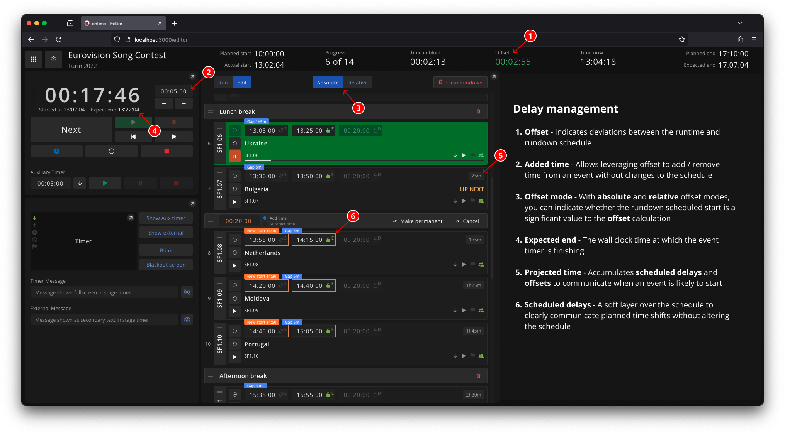

Shows run late. Ontime gives you four tools to handle it and keep the team informed:

| Tool | Use it when | Changes the schedule? |
| :--- | :--- | :--- |
| [Added time](#added-time) | The current event needs more or less time | No |
| [Scheduled delay](#scheduled-delays) | You want to tell everyone the rest of the show moves | No, until you apply it |
| [Expected time](#expected-time) | You want to know when upcoming events will really start | No, Ontime calculates it |
| [Offset](#offset) | You want to know how far ahead or behind you are | No, Ontime calculates it |

## Added time

Add or remove time from the running event, from the Editor or [the API](/api/protocols/http/#playback). \
It changes the event's expected end and the offset, but not the rundown schedule.

## Scheduled delays

A scheduled delay tells the team that everything after it moves, for example "doors open 10 minutes late". \
It sits on top of the schedule, so the original times stay visible. Every view shows it.

- A delay carries on through the rundown until a gap in the schedule is big enough to absorb it.
- When you are sure, **apply** the delay to make it part of the schedule. Ontime then stops treating it as a deviation.

## Expected time

Expected times show when each upcoming event will really start, based on the current offset and scheduled delays.

## Offset

The offset is how far the show has drifted from the schedule. It is negative when you run late and positive when you run early. \
Choose how Ontime calculates it with the **Absolute** and **Relative** toggle in the rundown header.

| Mode | Compares | Use it for |
| :--- | :--- | :--- |
| **Absolute** (default) | The current time with the scheduled times | Shows with a fixed start time |
| **Relative** | Elapsed time with the time since the rundown actually started | Rehearsals, recordings, and rundowns that start at `00:00:00` |

In absolute mode, a rundown that starts at `00:00:00` is read as midnight, so it shows a large offset straight away. Relative mode avoids this.

### Example

The rundown is scheduled to start at 09:00, with Event A from 09:00 to 10:00. You start it at 09:10.

- In absolute mode, the offset is `-00:10:00`, and the expected end is 10:10.
- If Event A is set to **Count to End**, it still ends at 10:00, so the offset stays `00:00:00`. If it runs past 10:00, the overtime becomes the offset.

:::tip[Hard deadlines]
**Count to End** timers, set in the event editor, always count down to their scheduled end, whenever they start. Use them for fixed deadlines such as a broadcast start or a crew cut-off.
:::
