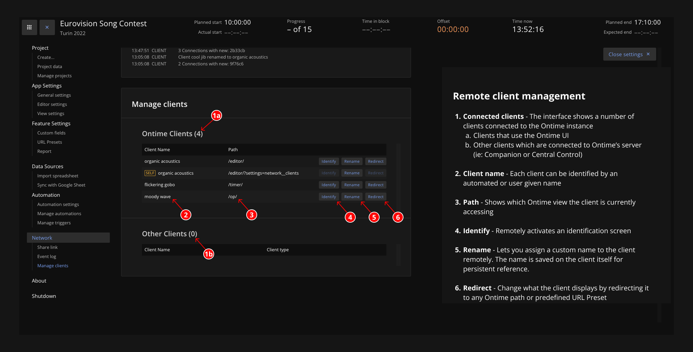

In a live production environment, Ontime will have multiple connections to its server.
- Operators reading their cues
- Confidence monitors onstage
- Public schedules displayed in the foyer
- Automation systems like Companion or Central Control

It is sometimes desirable to be able to modify what is shown to the clients from a central place in Ontime's interface. \
This is especially the case in devices with no input (such as PA displays), but also for productions where we prefer having tight control over the system setup.

Open `Editor` -> `Settings` -> `Network` -> `Manage clients`. To give each view a short, memorable link, use [URL presets](/features/url-presets/).

This interface gathers tools to let you manage connections to Ontime's server
- Monitor all active connections to Ontime
- Discover and identify clients
- Assign descriptive names for easy reference
- Redirect any client to a different interface or preset remotely
