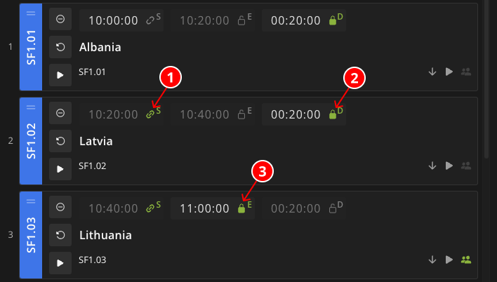

## Event times

Events have three time fields: `Start time`, `End time` and `Duration`. Any two define the third, since `Duration = End time - Start time`.

[Link an event's start](#link-start) to the previous event, and choose which field stays fixed with the [time strategy](#time-strategy). When the schedule changes, Ontime then updates all the events that follow.

### Link start
The start of an event can be linked to the end of the previous event.

Turn it on with the link button next to the `Start time` field (*note 1 in the screenshot*). Ontime then keeps the start time in sync with the previous event's end time.

This only changes the schedule. It does not start the event automatically.

:::note[Automate rundown progress]
To move through the rundown automatically, set the event's `End Action`: \
`None (default)` `Load Next` `Play Next`
:::

### Time strategy
The time strategy decides which field stays fixed when the schedule changes: the `Duration` or the `End time`. \
By default, Ontime keeps the `Duration`. Change the default in `Editor` -> `Settings` -> `Project settings` -> `Rundown defaults`, or set it per event with the lock next to the field (*note 2 locks the end, note 3 locks the duration*).

Considering the rundown from the above screenshot, what would happen if the End time of the first event (Albania) changed?
- If the event below (Latvia) has a **locked duration**, the End time will be pushed forward to maintain the event duration.
- If the event below were to have **locked End time** (as we do in Lithuania), the duration would be reduced to maintain the event end schedule. 

## Time entry shortcuts
Type times quickly with these shortcuts. They work in every time field.

| Entry                                   | Result                                                  | Note                                                                                                                                     |
| :-------------------------------------- | :------------------------------------------------------ | :--------------------------------------------------------------------------------------------------------------------------------------- |
| `1.20.3` `1 20 3` `1:20:03` `1,20,3`    | `01:20:03`                                              | `.` `,` `:` and `spaces` can be used as separators between `hh:mm:ss`                                                                    |
| `1.2.3` `1 2 3` `1:2:3` `1,2,3`         | `01:02:03`                                              | Three numeric fields are read as `hours:minutes:seconds`                                                                                 |
| `1.2` `1 2` `1:2`                       | `01:02:00`                                              | Two numeric fields are read as `hours:minutes`                                                                                           |
| `10`                                    | `00:10:00`                                              | A single numeric field (≤99) is read as `minutes`                                                                                        |
| `120`                                   | `01:20:00`                                              | A single numeric field (≥100) is separated into `hours` and `minutes`                                                                    |
| `1h30s`                                 | `01:00:30`                                              | `h` `m` and/or `s` can be used to indicate specific components                                                                           |
| `120m`                                  | `02:00:00`                                              | Named numeric fields can overflow                                                                                                        |
| `p`                                     | `09:00:00` (if previous event finishes at 09:00:00)     | The keyword `p` returns the end time of the previous event                                                                               |
| `+10m10s`                               | `09:10:10` (if previous event finishes at 09:00:00)     | Starting a time entry with a + sign, adds the time to the previous event                                                                 |
| `2.2.2` `2 2 2` `2:2:2` `2,2,2`         | `02:02:02`                                              | Leading zeros are not necessary                                                                                                          |
| `10:` or `:10`                          | `10:00:00` or `00:10:00`                                | Separators can be used to indicate where zero is omitted                                                                                 |
| `123456`                                | `12:34:56`                                              | Enter a full time-tag without separators (`hhmmss`; Note that you need six digits for this, otherwise it will be interpreted as minutes) |
